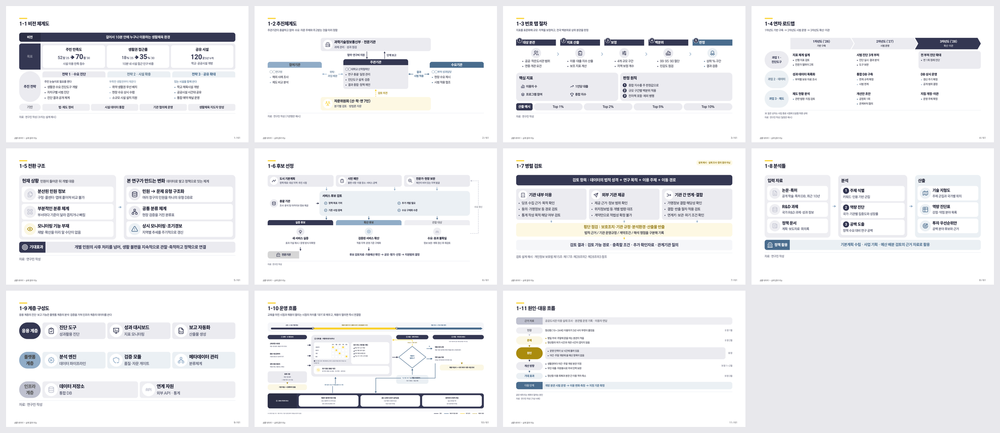
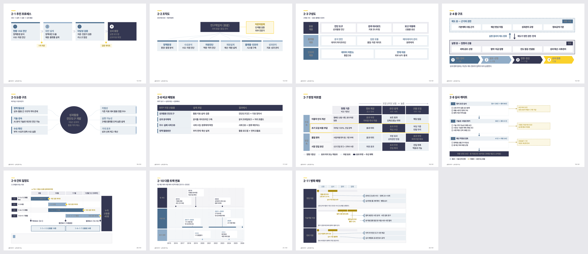
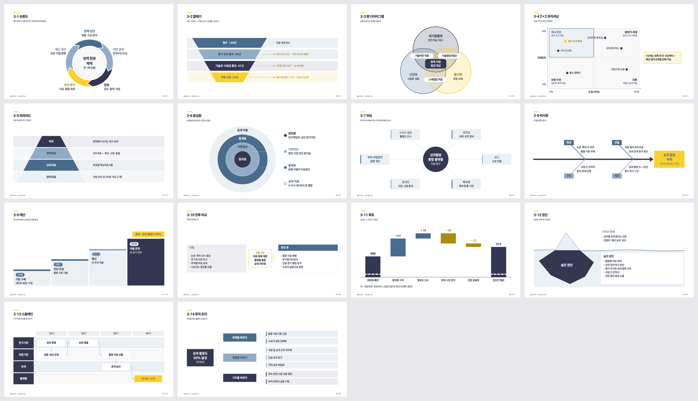
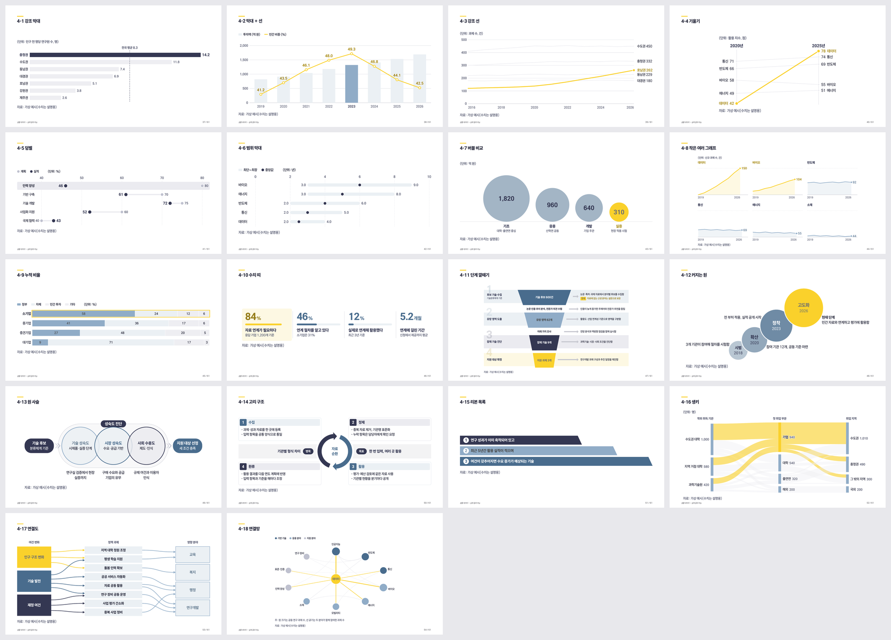
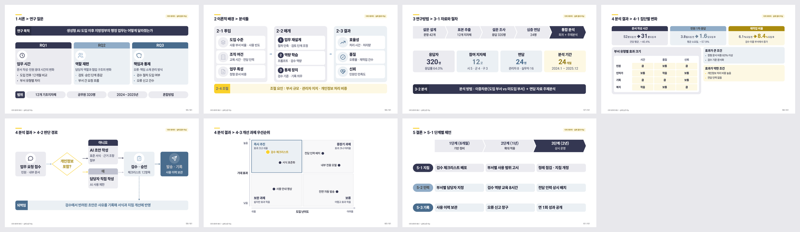

# doc-figure-multicolor

[doc-figure](https://github.com/parkjui92/doc-figure)를 포크해 **멀티 컬러차트와 색 체계, 16:9 발표 덱**을 더한 업데이트판. 스킬 이름과 설치 폴더도 `doc-figure-multicolor`.

## 이번 업데이트

- **멀티 컬러차트**: 공개 프레젠테이션 팔레트 28개(P-01~P-28)를 같은 미니 슬라이드에 입혀 비교하고 번호로 골라 컨셉으로 만든다
- **컬러 컨셉**: `jf-timeless`(P-01 남색·하늘색·노랑), `jf-serene`(P-02 파스텔) 등 컬러차트 색상 코드로 명시된 것만
- **내용 계열 색 7가지 + 흑백톤**: 논문 제목·초록으로 계열을 판별
- **16:9 발표 덱**: 여러 장을 HTML 하나로, 화살표·페이지 번호·전체화면
- **그라데이션·클릭 강조·페이지 고르기**: 그라데이션 체크(D), 클릭하면 글자 형광펜·상자 테두리·그래프 빛나기(C), 드래그 금지, 번호나 G 키로 페이지 칸 목록, 버튼마다 작은 단축키 표시
- **PDF 바로 저장**: 인쇄 대화상자 없이 지금 화면 그대로(색·글꼴·페이지 번호·잉크) PDF 파일을 내려받음
- **발표 도구·발표자 노트**: 펜·형광펜·레이저 포인터(P·H·L, 지우기 E·되돌리기 Z), spec `notes`를 별도 창에 띄우는 발표자 노트(S) — 지금·다음 슬라이드 미리보기·경과 시간
- **글자 대비 자동 보정**(SVG로 그린 상자 위 글자도 실제 바탕색으로 판정), 글자 값 표 전폭 표시
- **시작 질문**: 스킬을 부르면 글꼴(고딕·명조)과 발표 색상 컨셉을 먼저 묻는다
- **색상·글꼴 선택 상자**: 덱 아래에서 컬러차트 28색·흑백·웹폰트 12종을 고르면 같은 내용에 CSS만 갈아 끼워 다시 그림(`--switcher`)
- **그려지는 애니메이션**: 페이지를 열 때 상자가 차례로 떠오르고 그림이 펼쳐지며 화살표가 그어짐, 체크로 끔(PDF에는 영향 없음)
- **페이지 배치 고정**: 모든 페이지에서 제목 위치·크기가 같고, 판형(board) 밖 도식은 제목 아래 16:9 영역 가운데에 본문을 놓고 단위·출처는 그림 둘레에 붙임, 폭포 축 생략은 물결 표시
- **흑백 2종**: 흑백(`jf-mono-ink`)·그레이스케일(`jf-mono-gray`, 항목마다 명도가 뚜렷이 다른 회색 단계)
- **요소 기준**(`references/jf-elements.json`): 제목·제목 위 표식·부제·하단 글귀·페이지 번호 크기와 자리를 한 곳에서 정해 모든 페이지가 같게
- 원본 doc-figure v2.4(데이터 그래프·디자인 보고서풍 구조도)까지 병합, 원본 갱신은 주기적으로 병합

## 샘플

샘플 데이터로 만든 61쪽 — 도식 54종(조립 도식 11·템플릿 11·도식 형태 14·그래프·구조도 18) + 논문 PT 더미 7쪽(실제 결과 아님).

- **[samples/switcher.html](samples/switcher.html)** — 61쪽 덱. 아래 선택 상자로 색상(컬러차트 P-01~P-28 순서, 내용 계열 7, 흑백·그레이스케일)과 글꼴(눈누 웹폰트 고딕 6·명조 6)을 바꾸면 같은 내용에 CSS만 갈아 끼워 다시 그린다. 페이지를 열 때 그려지는 애니메이션(체크·A 키로 끔)
- **[samples/index.html](samples/index.html)** — 61쪽 이미지 갤러리, 페이지 이미지는 `samples/images/pages/`
- 샘플 설계 파일은 `samples/gallery-specs/`(원본 예시를 샘플 데이터로 정리: 제목은 번호 + 형태 이름)

| 묶음 | 모아보기 |
|---|---|
| 1 조립 도식 (11) |  |
| 2 템플릿 (11) |  |
| 3 도식 형태 (14) |  |
| 4 그래프·구조도 (18) |  |
| 5 논문 PT 더미 (7) |  |

## 개요

논문발표 PT·도식용 Claude Code 스킬. [parkjui92/doc-figure](https://github.com/parkjui92/doc-figure)(MIT)를 포크해 색 체계·페이지 틀·발표용 덱을 더했다. 도식 문법·레시피·`--verify` 점검과 원본 v2.4의 데이터 그래프(viz)·디자인 보고서풍 구조도는 원본을 그대로 쓴다. 원본 갱신은 주기적으로 병합한다. 원본 설명은 [README.doc-figure.md](README.doc-figure.md).

## 원본에서 달라진 것

| 영역 | 내용 |
|---|---|
| 색 | 논문 내용 계열 팔레트 7가지(`jf-policy` `jf-tech` `jf-method` `jf-risk` `jf-social` `jf-economy` `jf-green`), 흑백(`jf-mono-ink`)·그레이스케일(`jf-mono-gray`), 컬러차트 컨셉(`jf-timeless` P-01 남색·노랑, `jf-serene` P-02 파스텔, `jf-p03`~`jf-p28`) |
| 색 고르기 | `jf_palette.py pick`이 제목·초록 키워드로 계열을 판별. 새 컨셉은 컬러차트(공개 프레젠테이션 팔레트 28개)에서 골라 만든다 |
| 제목 | 논문의 장·절 번호 + 짧은 제목(`2 이론적 배경 > 분석틀`). 원본의 결론형 문장 제목은 쓰지 않음 |
| 페이지 | 16:9(1920×1080 기준), 비율을 유지한 채 화면 폭에 맞춤. 여백 64px·내용 폭 1792px 고정, 제목 42px 고정, 바깥 배경과 페이지 색 분리, 높이 88~100%를 채우도록 자동 조정 |
| 글꼴 | 눈누(noonnu.cc) 인기 웹폰트 12종 — 고딕: 프리젠테이션(기본)·프리텐다드·페이퍼로지·SUIT·에스코어드림·G마켓 산스 / 명조: Noto Serif KR(기본)·마루부리·부크크 명조·고운바탕·나눔명조·리디바탕. `--font <키>` (`references/jf-fonts.json`) |
| 덱 | 여러 장을 HTML 하나로. 화살표·페이지 번호·키보드 이동, 전체화면 발표(조작 막대 없음, 클릭·키보드로 넘김), 하단 페이지 번호·논문 제목, PDF는 페이지마다 1920×1080 한 장 |
| 대비 | 그린 뒤 글자와 실제 바탕의 대비를 재서 모자라면 글자색 자동 보정(알약·꼬리표 포함). 글자 값 표는 폭을 채우는 표로 |
| 장식 | 카드·셀 옆 세로 색 막대는 쓰지 않음 |
| 빌드 | 크롬·파이썬 패키지 없이 표준 라이브러리만으로 HTML을 만든다(`jf_build_html.py`, `jf_build_deck.py`) |

## 설치

```bash
git clone https://github.com/junedevkr/doc-figure-multicolor ~/.claude/skills/doc-figure-multicolor
```

## 쓰는 법

```bash
# 내용 계열 판별
python3 scripts/jf_palette.py pick --text "논문 제목과 초록"

# 한 장
python3 scripts/jf_build_html.py 그림_01.json

# 여러 장 덱 (모든 페이지 프리셋을 한 번에 바꾸려면 --preset)
python3 scripts/jf_build_deck.py 그림_01.json 그림_02.json -o 페이지모음.html --title "제목" --footer "논문 제목" --preset jf-serene --font myeongjo

# 컬러차트 (공개 팔레트 28개를 미니 슬라이드에 입혀 비교, 번호로 고름)
python3 scripts/jf_color_chart.py -o 컬러차트.html

# 팔레트 고친 뒤
python3 scripts/jf_palette.py build && python3 scripts/jf_palette.py check
```

덱 단축키: ← → · Space 넘김, F 전체화면, N 하단 페이지 번호 보이기·숨기기, Esc 전체화면 끝.

## 파일

| 경로 | 내용 |
|---|---|
| `SKILL.md` | 스킬 본문. 앞부분 'doc-figure-multicolor 규칙' 1~5절이 원본과 다른 규칙 |
| `references/jf-color-system.md` | 색 체계·컨셉·tone 뜻 |
| `references/jf-palettes.json` | 계열 팔레트·컨셉 원본 값 |
| `references/jf-source-palettes.json` | 컬러차트용 팔레트 28개(P-01~P-28) |
| `references/jf-font.css` | 프리젠테이션 웹폰트 |
| `scripts/jf_palette.py` | 프리셋 생성·대비/구별 검사·판별·PT 테마 JSON·미리보기 |
| `scripts/jf_page.py` | 16:9 페이지 틀·글꼴·자동 맞춤 |
| `scripts/jf_build_html.py` · `jf_build_deck.py` | 한 장·덱 빌드 |
| `scripts/jf_color_chart.py` | 컬러차트 |
| `samples/` | 샘플 61쪽 덱(switcher.html)·이미지 갤러리(index.html)·페이지 이미지·샘플 설계 파일 |
| `examples/jf-demo/` | 더미 데이터 도식 7장(연구 질문·분석틀·자료와 절차·집단별 변화·판단 경로·2×2·단계별 제언) |
| `원본출처.md` | 포크 시점과 변경 기록 |

## 라이선스

MIT. 원본 저작권 표기(parkjui92)는 [LICENSE](LICENSE)에 그대로 둔다. 아이콘은 Tabler Icons(MIT), 글꼴은 프리젠테이션(눈누 배포) 웹폰트를 CDN으로 불러온다.
